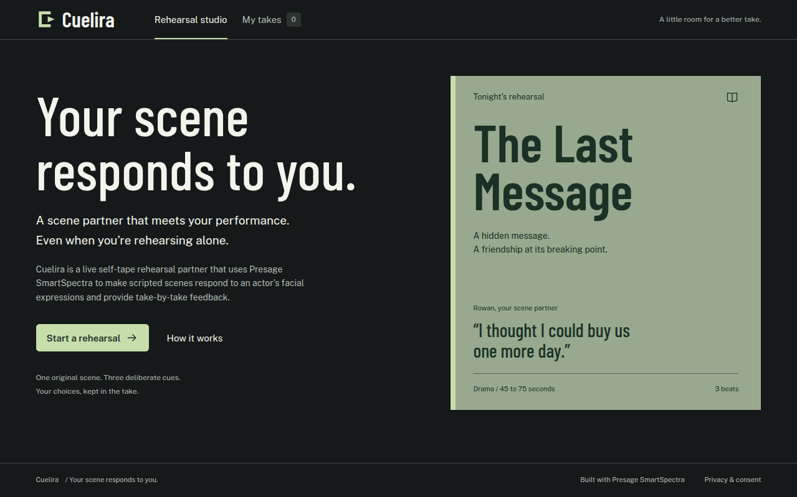

# Cuelira

**Final physical-camera acceptance:** Presage support confirms that virtual cameras, including phones through Windows Virtual Camera, are unsupported. Run `npm run sdk:native` in the Windows checkout and explicitly select the Dell built-in webcam or a directly connected USB webcam. [One-test instructions and go/no-go rule](docs/TESTING.md#single-direct-native-acceptance-test). Physical native expression delivery remains unverified until that real hardware test passes; the existing rehearsal is unchanged.

### Your scene responds to you.

Cuelira is a live self-tape rehearsal partner that uses Presage SmartSpectra to make scripted scenes respond to an actor's facial expressions and provide take-by-take feedback.

[Run locally](#run-locally-native-windows) | [Verify the live SDK](docs/TESTING.md) | [Judge walkthrough](docs/JUDGE_WALKTHROUGH.md) | [Readiness](docs/FINAL_READINESS.md)

**Current evidence:** Electron app, native acceptance diagnostic, automated regression tests and a [previous passing Windows installer/runtime CI run](https://github.com/sopskistar/Cuelira/actions/runs/44914798837). **Genuine physical-camera expression recognition and accepted live cues remain UNVERIFIED; the final demo video is INCOMPLETE.** An authenticated live rehearsal and actual performance footage are still required.

**Compatibility decision:** the virtual-camera investigation is closed as unsupported, based on Presage's clarification supplied by the user. A working browser preview does not establish SDK compatibility. Do not repeat phone/virtual-camera tests. If native physical capture fails on the Dell and no directly connected USB webcam is available, the project is **blocked**; stop speculative development.



_Actual Electron screenshot. Camera off, no fabricated face or measurements._

I use the official **SmartSpectra 3.5.0** main/preload/renderer lifecycle, explicitly requesting **`faceMetrics`**. A fresh, stable, validated facial cue advances Rowan's authored response in **The Last Message**, my original three-beat rehearsal. The final neutral cue requires a new non-neutral departure and a controlled return. Review distinguishes accepted SDK observations from manual continuations; it never scores acting ability or infers internal feelings.

Inspect [capture](src/sdk/live.ts), [payload normalization](src/core/normalize.ts), [cue/state engine](src/core/engine.ts), and [main credential/consent policy](electron/sdk-policy.ts). [Integration details and limits](docs/SMARTSPECTRA_INTEGRATION.md).

## Run locally: native Windows

Use Windows PowerShell, Node **22 or 24 x64**, and a Windows checkout. Do not share WSL `node_modules` with Windows.

```powershell
git clone https://github.com/sopskistar/Cuelira.git
cd Cuelira
npm ci
Copy-Item .env.example .env
notepad .env
# Save your private Presage key in PRESAGE_API_KEY; close the editor.
npm start
```

Use an existing Windows checkout if already cloned. Get a developer key from [Presage](https://physiology.presagetech.com/auth/register). The key stays in local configuration/main memory, never in renderer assets or Git. No app login, paid model, voice service or cloud database is added. SmartSpectra still requires its own authentication/network access. Close other camera apps and enable Windows desktop-camera access.

For UI-only development, `npm run dev` opens a clearly labeled browser preview. Manual practice works without a camera; it cannot verify SmartSpectra.

## Verify a genuine take

1. Run the single native physical-camera acceptance test above first. Select the Dell built-in or directly connected USB webcam; virtual/phone cameras are unsupported. Only after a genuine native pass should that path be integrated into the rehearsal. Recording remains a separate optional consent, off by default.
2. Wait for **Running and fresh facial metrics**, not just a webcam preview.
3. Begin the scene, speak Alex's lines and perform surprise, angry, then a deliberate non-neutral → neutral return. Let each armed cue stabilize.
4. Confirm Rowan answers **because of an accepted observation**. Wrong/no-face/stale cues must not pass. Manual continuation must remain labeled manual.
5. Finish, inspect the review and export JSON/text. If enabled, play/export the silent video. Delete the take to remove app-stored files.

[Exact Windows acceptance and evidence checklist](docs/TESTING.md). Provisional thresholds have not been calibrated on a real face. No camera or developer key was exposed in the WSL build environment.

## Checks and packaging

```sh
npm run build
npm test
npx playwright install chromium
npm run test:gui
npm run security
npm audit
npm run package:win
```

The Windows package command should run natively on Windows. Linux unpacked packaging uses `npm run package:linux`. No native rebuild step is needed for this FFI SDK. [Verified CI run](https://github.com/sopskistar/Cuelira/actions/runs/44661497725) includes build/tests/browser checks, an unsigned Windows installer, and a packaged Windows launch/native-library/manual-persistence check. Its **Cuelira-Windows-unsigned** artifact contains the installer. This development artifact is unsigned; no camera or authentication was tested in CI.

## Privacy and honest evidence

Camera consent is explicit. Optional silent video and reports remain locally until deleted; exports and provider records are separate. Pause leaves the camera on; Stop camera releases it. There are no psychological, medical or talent-scoring claims.

Optional SDK telemetry is disabled, but this does **not** mean offline or no provider communication. Presage's current policy describes authentication, usage and automatic Insights processing independently of telemetry. This face-only configuration requests no vitals and sends no prompts; native network traffic has not been independently audited. Read [my full disclosure](docs/PRIVACY_AND_CONSENT.md) and [Presage's SDK policy tab](https://presagetech.com/legal/privacy-policy).

| Evidence                                                             | Status                                                          |
| -------------------------------------------------------------------- | --------------------------------------------------------------- |
| Actual Electron launch, native library load, manual workflow/storage | VERIFIED in WSL and packaged Windows CI                          |
| Protobuf decoding, recognition, neutral guard, error recovery        | TESTED WITH FIXTURES                                            |
| Playable optional video                                              | TESTED WITH SYNTHETIC CANVAS; real webcam NOT TESTED            |
| Authenticated human facial cue → response → review                   | NOT TESTED                                                      |
| Final genuine demo and DEV publication                               | INCOMPLETE                                                      |
| Contest submission acceptance                                        | VERIFIED public page shows Live; actual submission not attempted |

## Evidence and design notes

- [Requirements and deadline/status check](docs/HACKATHON_REQUIREMENTS.md), [winner research](docs/WINNER_RESEARCH.md), [competitors](docs/COMPETITOR_ANALYSIS.md), [differentiation](docs/DIFFERENTIATION.md).
- [Architecture](docs/ARCHITECTURE.md), [scene script](docs/SCENE_SCRIPT.md), [interaction rules](docs/SCENE_INTERACTION_RULES.md), [threat model](docs/THREAT_MODEL.md).
- [Original visual identity](docs/BRAND_IDENTITY.md), [demo storyboard/capture instructions](docs/DEMO_STORYBOARD.md), [editable video project](video/src/index.tsx).
- [Build discoveries](docs/BUILD_DISCOVERIES.md), [testing](docs/TESTING.md), [final readiness](docs/FINAL_READINESS.md), [unpublished DEV draft](docs/DEV_SUBMISSION.md).

I began this repository during the challenge period and preserve its genuine history. My application, original dialogue and vector assets use the existing [MIT license](LICENSE), copyright **Udeorji Sopuruchi Juliana**. The Presage SDK and other dependencies retain their own [licenses and notices](docs/THIRD_PARTY_NOTICES.md).
