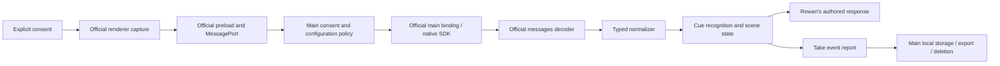

# Architecture

I use one Electron window and the official SmartSpectra Electron lifecycle. Application logic is pure TypeScript; private storage and credentials belong to main.

| Responsibility                                         | Source                                     |
| ------------------------------------------------------ | ------------------------------------------ |
| Secure window, IPC, permissions and credential loading | `electron/main.ts`                         |
| Main-only configuration guard on the official SDK port | `electron/sdk-policy.ts`                   |
| Official preload plus narrow local-storage bridge      | `electron/preload.ts`, `scripts/build.mjs` |
| Capture lifecycle and official event subscriptions     | `src/sdk/live.ts`                          |
| Payload normalization and timestamp conversion         | `src/core/normalize.ts`                    |
| Scene, schema, thresholds and report text              | `src/core/model.ts`                        |
| Arming, stabilization, transitions and recovery        | `src/core/engine.ts`                       |
| User journey, review and optional video                | `src/ui/App.tsx`, `src/ui/recorder.ts`     |
| Atomic local reports, video, exports and deletion      | `electron/store.ts`                        |

## Lifecycle

The UI progresses welcome → consent → preparation → ready → rehearsal → completed → review. The engine separately models ready, rehearsing, paused, error, completed and stopped. A capture error disarms the scene and releases capture; recovery requires retry and explicit resume. Pause leaves the camera on; Stop camera releases it. Restart saves the interrupted take and returns to fresh consent.

I checkpoint reports every five seconds and save at normal end/restart. Storage serializes atomic temp-file replacements. After an unexpected close, the next launch marks unfinished reports stopped, using the last persisted event time and explicitly saying the exact interruption time is unknown. Up to five seconds of uncheckpointed events and an unfinished in-memory video can be lost. There is no automatic cloud backup.

The SDK owns the frame pump, native singleton barrier and port teardown. I do not implement a replacement webcam/native transport. The additional main-side policy relies on the inspected 3.5.0 wire contract because public `bindSmartSpectraIpc` has no credential/configuration hook. It must be re-audited on SDK upgrades; tests pin the contract. See [integration detail](SMARTSPECTRA_INTEGRATION.md).
